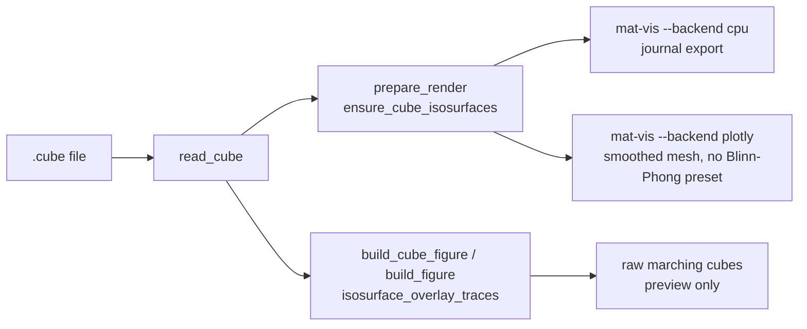

# Cube and isosurface API

Cube support is a volumetric-data adapter, not an independent chemistry
renderer. Atomaestro parses the grid, sends the embedded atoms and periodic
cell through the canonical MolCrysKit structure contract, and then adds the
positive and negative isosurface meshes to the backend-neutral scene.



## Installation boundary

- Parse ordinary structures and render PNG/PDF/SVG: base `matter-vis`.
- Parse a Cube grid and extract isosurfaces: `matter-vis[cube]`.
- Render a Cube scene to Plotly HTML: `matter-vis[cube,plotly]`.
- Use Plotly/Kaleido static export: `matter-vis[cube,plotly-export]`.

Run `mat-vis capabilities --require cube --json` for the exact command in the
current environment. Importing `mat_viewer`, `mat_viewer.cube`, or
`mat_viewer.cube.core` does not import scikit-image or Plotly; those packages
are loaded only when their adapters are called.

## Agent-first entry points

Use the same public API as other structure formats:

```python
from mat_viewer.agent import load_structure, prepare_render, render

source = load_structure("density.cube")
plan = prepare_render(source)
result = render(plan, output="density.svg", backend="cpu")
```

The equivalent CLI is:

```console
mat-vis render density.cube -o density.svg --backend cpu --check --json
mat-vis render density.cube -o density.svg --backend cpu --json
```

`--check` resolves `[cube]` without loading the file or creating output.

`build_cube_figure(path, ...)` is the Plotly figure helper. It still obtains
atoms, bonds, image shifts, and display fragments from the canonical loader,
then `build_figure` adds `isosurface_overlay_traces`. That overlay reruns
`skimage.measure.marching_cubes`. It does not call `ensure_cube_isosurfaces`,
does not Taubin-smooth, and uses Mesh3d lighting ambient 1, diffuse 0,
specular 0. It is a preview, not a journal figure.

## Stable data surface

- `CubeAtom` and `CubeData` hold embedded atoms, origin, axes, and scalar data.
- `read_cube(path) -> CubeData` performs pure Cube IO.
- `cube_atom_trace(cube, theme="canonical")` and
  `atom_sphere_traces(cube, theme="canonical")` use the canonical Atomaestro
  element palette by default. Pass `theme="cpk"` explicitly for the legacy
  bright CPK colors; this choice affects only the cube atom/bond overlays.
- `tile_cube` and `tile_cube_data` explicitly replicate a scalar grid.
- `default_isovalue(values, percentile)` chooses a threshold strictly inside
  the positive/negative value range or fails when no surface can exist.
- `cube_isosurface_meshes(cube, ...)` in `mat_viewer.cube.cpu` lazily uses
  scikit-image and returns backend-neutral vertices, triangles, normals,
  colour, opacity, and ambient/diffuse material coefficients. Pass
  `color_cube` to attach per-vertex RGB sampled from a second `CubeData`.
  Positive and negative phases stay separate meshes.
- `prepare_render` calls `ensure_cube_isosurfaces`. Taubin filtering
  (λ = 0.5, μ = −0.53, 15 iterations) runs only when `isosurface_smooth`
  is true. The default is the historical raw mesh at stride 2.
  `mat-vis render --backend cpu --isosurface-stride 1 --isosurface-smooth`
  draws the fine publication mesh.
  `mat-vis render --backend plotly` draws the same prepared geometry through
  `render.plotly`. Smoothing is a visual filter: it does not change which
  voxels are inside the surface. Vertices on the cube-box boundary stay
  pinned, and any vertex the μ step carries past the data box is placed
  back on that face before normals and colors are computed. Normals are the
  scalar-field gradient, sampled with central differences and mapped by
  `(J^{-1})^T`. A vertex with a tiny gradient, or one outside the grid,
  keeps the area-weighted mesh normal. The gradient field is flipped
  together when it disagrees with that marching-cubes winding.
  Omitting `--isosurface-smooth` keeps the raw marching-cubes mesh. A second
  cube's colors are resampled at the vertices that are drawn.
  `render.plotly` does not pass `surface_material` into Mesh3d lighting, so
  `hard_plastic`, `metal_like`, and `glass_like` are rejected on
  `--backend plotly` and `--backend gpu` instead of being attached and ignored.
- `build_cube_figure` and `build_figure` do not use those meshes.
  `isosurface_overlay_traces` and `orbital_mesh_traces` rerun raw
  `skimage.measure.marching_cubes` and ignore `scene["isosurfaces"]`.
  Their Mesh3d lighting is ambient 1, diffuse 0, specular 0. That path is
  an interactive preview, not publication quality. Journal figures use
  `mat-vis render --backend cpu`.
- `ensure_cube_isosurfaces(structure)` stores the prepared CPU meshes.
  They are kept only while the source grid, isovalue, stride, smoothing,
  material, and color-cube settings still match. The preparation token
  defaults to the same raw-mesh contract as that function. Those meshes
  are what `prepare_render` consumes. `build_figure` does not.
- CPU, CLI, and the builtin style default to `isosurface_stride=2` and
  `isosurface_smooth=False`. `--isosurface-stride 1 --isosurface-smooth`
  is the fine publication mesh.

`--isosurface-ambient` and `--isosurface-diffuse` are the historical Lambert
pair used when no specular preset is selected. `RenderSpec` still requires
that pair's sum to be at most 1. The defaults 0.68 and 0.32 reproduce that
Lambert response and do not add a specular highlight.

`surface_material` is a separate CPU record. Its ambient and diffuse need
not sum to 1. `matte` keeps the historical response. `hard_plastic` and
`metal_like` add specular highlights on the smoothed CPU vertex normals.
On a translucent isosurface the CPU PNG compositor adds that specular
without multiplying it by the surface opacity. `glass_like` also clears the
face-on center and thickens the silhouette; opaque atoms and bonds stay
opaque. They do not recolor the phase. Plotly Mesh3d lighting does not
evaluate them, including on a Taubin mesh from `mat-vis render --backend plotly`.
`hard_plastic`, `metal_like`, and `glass_like` are rejected on `--backend plotly`
and `--backend gpu`. Opacity stays 0.55 unless `--isosurface-opacity` is set,
and that value still scales the glass rim. Historical 0.68 and 0.32 do not
conflict with `matte`. `metal` and `glass` are rejected. See
[`surface_material.md`](surface_material.md). `build_cube_figure` does not
evaluate these presets.

```bash
mat-vis render orbital.cube -o raw.png --backend cpu --renderer general
mat-vis render orbital.cube -o smooth.png --backend cpu --renderer general \
  --isosurface-stride 1 --isosurface-smooth
```

## Isosurface material

`IsosurfaceMaterial` copies coefficients from the surface-material library.
It does not keep a private preset table. `opacity` is the object alpha and
is not part of the coefficient record. `light_scale` raises and is not
folded into diffuse or specular. Omitted coefficients stay the historical
Lambert pair, ambient 0.68 and diffuse 0.32, specular 0. A number on
`RenderSpec` is explicit even when it equals that default, so it conflicts
with `isosurface_material`.

The CPU surface shader evaluates the copied record, including `glass_like`
Fresnel and `metal_like` base tint. `shade_albedo`, Matplotlib, and Plotly
reject a non-neutral Fresnel record or a non-white specular tint instead of
dropping it. Plotly forwards in-range ambient, diffuse, and specular
unchanged and uses its own Cook-Torrance highlight. The GPU backend rejects
an isosurface mesh rather than drawing one flat color.
  Pass `density_mask=True` with a density `CubeData` and `density_cutoff`
  to drop triangles whose sampled density is above that cutoff. The flag
  defaults off.
- `ensure_cube_isosurfaces(structure)` attaches those meshes to the canonical
  scene consumed by CPU, matplotlib, Plotly, and GPU renderers. One mesh list
  is stored and replaced when the source grid, isovalue, stride, material,
  color-cube, or active density-mask settings change. A density cube is not
  part of that identity while the mask is off.


## Isosurface color

`--isosurface-color-cube` samples a second cube onto the isosurface in
physical coordinates. The position of a mesh vertex is the source cube's
origin plus that vertex in the scene frame. The color value is the
trilinear sample of the full-resolution color grid at the index implied by
the color cube's own origin and voxel axes. Equal array shapes are not
enough: a different origin or voxel vector selects a different scalar, and a
vertex that falls outside the color grid is an error.

`--isosurface-stride` coarsens only the marching-cubes mesh. It does not
downsample the color cube. `--isosurface-colormap bgr` maps the low end to
blue, the middle to green, and the high end to red. Other names use
Matplotlib. `--isosurface-color-range MIN MAX` sets that mapping. Omit it to
use the finite minimum and maximum of the color cube. A finite constant cube
with no range uses the colormap midpoint, which is green for `bgr`. A
supplied range maps a constant value through that range.
`--isosurface-color-center` places one value, often zero, at the middle of
an asymmetric range.

Sampled colors are the albedo for the shared material. Shading multiplies
them and may add a white specular term; it does not replace the colormap.
A nonfinite voxel with nonzero trilinear weight makes that sample an error.
A nonfinite voxel with zero weight does not: an exact grid point or grid
face ignores the unused corners, so `NaN * 0` is not evaluated. Nonfinite
voxels the surface does not touch are ignored. Omitting the color cube
keeps the positive and negative phase colors.

| Mode | Backend | Color |
|---|---|---|
| `surface` | CPU PNG | Per-vertex color, then the shared material. Smooth shading uses vertex normals; flat shading keeps the same colors with one illumination per face. |
| `surface` | CPU SVG/PDF | Per-face average of the vertex colors. Vector fills are one color per triangle. |
| `surface` | Plotly | `Mesh3d` vertex colors. |
| `wireframe` | CPU PNG | Endpoint colors along the projected edge. Perspective uses camera depth (`-z`), so depths 1 and 9 give the screen midpoint weights 0.9 and 0.1. |
| `wireframe` | CPU SVG/PDF | The same blend, drawn as solid steps of 4 px. A span is not replaced by its midpoint color. |
| `wireframe` | Plotly | Error for per-endpoint colors. Use the CPU backend or `surface`. Wireframe lines are unlit and do not apply the shared material. |
| either | matplotlib or GPU | Error. Those backends do not accept per-vertex or per-endpoint colors. |

```console
mat-vis render density.cube -o density.png --backend cpu \
  --isovalue 0.005 \
  --isosurface-color-cube potential.cube \
  --isosurface-color-range -0.04 0.02 \
  --isosurface-color-center 0 \
  --isosurface-colormap bgr
```

## Density mask

Optional high-density ceiling for an interaction isosurface such as a reduced
density gradient (RDG) or an interaction region indicator (IRI). The mask is
off unless you turn it on. Orbital and electron-density isosurfaces are
unchanged when the flag is omitted, even if a density-cube path and a cutoff
are sitting on the render spec. Do not enable the flag to clip an orbital or
a density isosurface. Cutting a density surface at ρ_cut only truncates that
contour, and this flag does not do that unless you turn it on for that render.

The cutoff uses the density cube's scalar values. For electron density those
values are atomic units, e/Bohr³ (1 a.u. ≈ 6.748 e/ų, so 0.05 a.u. ≈ 0.337
e/ų). MatterVis does not convert e/ų. `read_cube` converts coordinates to
angstroms and leaves the scalars untouched.

When the mask is on, pass both a density cube and a cutoff ρ_cut > 0. If
either is missing, or the cutoff is not finite and positive, preparation
stops with an error. The isosurface is not masked by a silent default. The
program does not choose, infer, or correct ρ_cut.

Marching cubes runs on the loaded field. ρ is then sampled at the mesh
vertices in one Cartesian frame: the source origin plus voxel axes, mapped
into the density cube's own origin and axes. A grid with different spacing
or shape is sampled with trilinear interpolation when that frame covers the
surface. A triangle is drawn only when every vertex has ρ ≤ ρ_cut. Vertices
above the cutoff are not drawn. The field cube, the density cube, and any
colour cube are not rewritten. Colour range and colour mapping stay on the
full colour cube. Surviving vertices are not used to rescale sign(λ₂)ρ or
d_norm.

A density grid that cannot share that frame, including a Bohr grid that was
not stored in angstroms, or a grid that does not cover the surface, is an
error. A much coarser density grid still samples, and the clip can look
stair-stepped. This is a high-ρ ceiling. It is not a vacuum floor and it is
not a low-ρ Hirshfeld mask.

`ensure_cube_isosurfaces` keeps one mesh list on the scene and replaces it
when the isovalue, stride, material, colour cube, or active density mask
changes. A density cube that is not used, because the mask is off, is not
part of that identity. Cutoffs are not stored as a history.

State the mask and the cutoff in the figure caption. 0.05 a.u. is a
literature starting point for weak NCI/RDG contacts, not a software default
and not a universal value. The same 0.05 a.u. must not be copied from a
DFT/NCI convention onto a promolecular Slater field, and it is not
interchangeable across molecules, hydrogen-bond strengths, or descriptors.
Stronger or cyclic hydrogen bonds can sit above 0.05 a.u. in the interaction
region; 0.10 a.u. is only an example of a higher ceiling to try, not a second
default. For a standard IRI figure, leave the mask off. Those figures are
meant to show covalent basins and weak contacts together. A 0.05 ceiling is
an NCI-style crop and can delete strong hydrogen-bond basins.

A cutoff is also not a geometric bond-midpoint density. On one promolecular
Slater field for the formic acid cyclic dimer (not a DFT density), the H···O
midpoint was ρ ≈ 0.09 and was not a critical point. Using that midpoint as
ρ_cut would erase the RDG hydrogen-bond sheets on that field (ρ ≈ 0.037–0.051)
while remaining far below the IRI value at the same midpoint (about 3). On
that field the hydrogen-bond IRI isosurface sat near 1.5, against an RDG
isosurface near 0.5, and on a slightly different ρ neighborhood. Inspect ρ,
and the interaction field, on the isosurface of the descriptor you are
drawing. One global cutoff is not enough for both.

Without a mask, both an RDG isosurface near 0.5 and an official IRI
isosurface near 1.0 are flooded by covalent and atomic shells. Raising only
the density cutoff does not make IRI = 1.0 show hydrogen-bond disks on that
promolecular field: the attractive IRI on the RDG ≈ 0.5 hydrogen-bond sheet
was about 1.44–1.60. That is a field and isovalue question. It is not a
reason for the program to pick a cutoff.

Promolecular and SCF densities for the same geometry can disagree. A cutoff
that works on a mock can be too tight or too loose on a DFT cube. The mask
does not repair an inverted IRI definition or a nonstandard RDG prefactor.
Prefer an unmasked field cube plus this flag. The flag does not rewrite a
cube that was already cleared outside the cutoff; sampling it again can
over-cut.

```console
mat-vis render rdg.cube -o rdg.png --backend cpu \
  --isovalue 0.5 \
  --isosurface-density-mask \
  --isosurface-density-cube density.cube \
  --isosurface-density-cutoff 0.05
```

The 0.05 in that example is a user's choice for a weak-interaction RDG
figure. It is not the default. Omit `--isosurface-density-mask` for
orbitals, electron density, and a standard IRI figure.

```python
from mat_viewer.cube.cpu import cube_isosurface_meshes
from mat_viewer.cube.io import read_cube

meshes = cube_isosurface_meshes(
    read_cube("rdg.cube"),
    isovalue=0.5,
    density_mask=True,
    density_cube=read_cube("density.cube"),
    density_cutoff=0.05,
)
```

`RenderSpec(isosurface_density_mask=True, isosurface_density_cube=..., isosurface_density_cutoff=...)`
is the same switch for `prepare_render` and `render`.

## Isosurface wireframe

Use `--isosurface-mode wireframe` to render each positive or negative cube
isosurface as the complete marching-cubes triangulation. Shared edges are
deduplicated, but triangulation diagonals are retained; the filled surface is
not drawn. This is independent of `--style wireframe`, which controls the
atom-and-bond representation.

```console
mat-vis render density.cube -o density.svg --backend cpu \
  --isovalue 0.005 --isosurface-mode wireframe \
  --isosurface-wireframe-width 1.0 \
  --isosurface-wireframe-opacity 1.0
```

The wireframe inherits `--isosurface-positive-color` and
`--isosurface-negative-color` when no color cube is given.
`--isosurface-stride` controls the marching-cubes mesh density. Sampled
endpoint colors are described in [Isosurface color](#isosurface-color).
Because this is a pure wireframe, rear edges are intentionally visible;
hidden-line removal is not promised. Dense meshes can produce large SVG/PDF
files.

Standalone `bond_traces`, `build_orbital_figure`, and
`build_orbital_panel_figure` are intentionally not exported. They inferred
chemistry from direct Euclidean distances, which loses periodic boundary bonds
and creates a second structure truth. Compose multiple completed views in an
external layout tool instead of using an independent panel chemistry path.

## Contracts and failure behaviour

- MolCrysKit owns bond thresholds, PBC image shifts, molecule grouping, rings,
  and formula-unit selection. Cube code never re-detects those relationships.
- `build_cube_figure(..., periodic=True)` and style `isosurface_periodic` on
  the legacy Plotly trace path close the scalar grid by appending wrapped
  endpoint planes. That does not create a structural supercell. `mat-vis
  render` does not do this. `--periodic-isosurface` is an error on that
  command, and `--no-periodic-isosurface` matches the CPU meshes.
- `periodic_image_policy="cell"` and `"nearest_atom"` are likewise read by
  that legacy trace path, not by `ensure_cube_isosurfaces`.
- `isosurface_atom_mask_radius` and `isosurface_min_volume_voxels` are builtin
  style keys read by the legacy Plotly trace builder and by
  `orbital_mesh_traces`. They are not CLI flags. `ensure_cube_isosurfaces`
  does not apply them, so they do not change `mat-vis render`.
- A missing `[cube]` extra raises an installation error. The renderer never
  drops an explicitly requested isosurface. It also does not invent a density
  cutoff when the mask is missing an input.
- CPU vector output remains true vector geometry. Plotly 3D PDF/SVG export is
  rasterized by Plotly/Kaleido and is therefore a distinct explicit backend.
- Supply the final Plotly camera to `build_cube_figure`; changing it after the
  figure is built can desynchronize baked compass annotations.

## Common checks

```console
mat-vis inspect density.cube --json
mat-vis capabilities --require cube --json
mat-vis render density.cube -o density.png --backend cpu --check --json
```

If marching cubes reports that the level does not cross the data, choose an
explicit isovalue inside the scalar range. If isolated noise components remain,
use the component-size and atom-mask controls deliberately; absence of their
optional implementation is an error rather than a visual fallback.

Publication orbitals, density, and Hirshfeld surfaces stay on `studio_soft`.
`unlit` is for color-critical NCI/IRI plots, not the journal default for
those surfaces. See [`lighting.md`](lighting.md).

## VTK offscreen figures

`mat_viewer.render.vtk_cube.render_cube_figure` is an experimental
offscreen helper. It writes one PNG through PyVista. It is not a
`mat-vis render --backend` choice, it does not consume a `RenderPlan`,
and it is not a second scene authority. Pixel output may differ from
the CPU and Plotly backends. This helper does not promise cross-backend
pixel parity.

Depth peeling (`depth_peels`), Taubin smoothing (`taubin_iterations`,
`taubin_pass_band`), and the native VTK window class are options on this
helper. The isosurface shade is a shared record, described below.

Install the Python extra with:

```console
python -m pip install "matter-vis[vtk]"
```

PyVista is imported only when the function is called. Windows selects
`vtkWin32OpenGLRenderWindow` and macOS selects `vtkCocoaOpenGLRenderWindow`.
Neither platform needs `DISPLAY`, OSMesa, or EGL. Headless Linux needs a
system OSMesa or EGL library (Debian/Ubuntu: `libosmesa6`). Atomaestro does
not install system libraries. On Linux, if no display and neither library is
loadable, the call raises `RuntimeError` before opening a window. A missing
library used to abort the interpreter inside VTK. Set
`VTK_DEFAULT_OPENGL_WINDOW` to keep a window class the local VTK build
provides.

The isosurface grid and the color grid share one `origin`, one `axes` matrix,
and one shape. Voxel vectors are rows. A vertex index `(i, j, k)` is the
physical point `origin + (i, j, k) @ axes`, the same frame as `CubeData`.
Resample a color cube that uses a different grid before calling this
function. Omit `color_min` and `color_max` to use the finite minimum and
maximum of the color grid. A constant grid with no range uses the colormap
midpoint. `color_center` places one value, often zero, at the middle of an
asymmetric range; omitting it keeps a linear map. `colormap_stops` is a
sequence of at least two RGB triples in `0..255`. The default stops run blue,
cyan, green, yellow, red.

`isovalue=None` uses `default_isovalue`. One level is drawn. `periodic=True`
appends the wrapped endpoint plane (index `N` copies index 0), the same
closure as the CPU cube path, so the surface can reach the cell faces.
`repeat` translates the finished mesh, the atoms, and the supplied bonds by
`axes * shape`. It is not `periodic_image_policy`. Pass
`bond_finder(xyz, atomic_numbers)` when contacts that cross a cell boundary
have to be chosen after the repeat. This function does not choose elements
or distance cutoffs. Colors and radii are caller-supplied maps keyed by
atomic number.

The isosurface shade is a `FigureShade` from
`mat_viewer.render.figure_shade`:

```python
from mat_viewer.render.figure_shade import FigureShade

surface = FigureShade(ambient=0.7, diffuse=0.45, specular=0.08, shininess=15)
```

Pass it as `surface=surface`. The fields are ambient, diffuse, specular,
and shininess. Those names are the shared Blinn–Phong coefficients: three
independent weights and a highlight exponent. This helper does not define
`SurfaceMaterial`, `MaterialSpec`, or `LightingRig`, does not look up
presets, and does not rename or rescale the four numbers. A mapping or any
other record that carries those four attributes is accepted in place of
`FigureShade`. `id` on that record is a label and is ignored. Optional
`specular_tint`, `specular_color`, and Fresnel fields are read with the
same meaning as the shared surface record. `shininess` is the highlight
exponent. This helper lowers it to VTK specular power (the Phong exponent),
not a 0–1 weight.

`lighting` selects how those coefficients are evaluated. Omit it to keep
the experimental three-light rig. That rig is not `studio_soft` and not
`studio_three_point`. A string id or a rig-shaped record (`id`, `kind`,
`direction`, `light_scale`) is accepted without defining `LightingRig`.
`studio_soft` (`kind="camera_directional"`, direction `(-0.32, 0.42, 1.0)`,
`light_scale` 1) installs that one camera-space light (`+Z` toward the
camera). `unlit` draws inherited colors and does not apply the directional
shade; the stored coefficients stay as given. `studio_three_point`
(`kind="multi_light"`) is rejected because that rig stores no directions
and this helper will not invent a rig under that name. A non-unit
`light_scale`, another camera-directional id, or a different
`studio_soft` direction is rejected rather than retuned. Fresnel fields
(`glass_like`), `specular_tint="base"`, a non-white `specular_color`, and
`opacity` or `light_scale` on the material record are rejected the same
way. The adapter does not claim CPU or Plotly pixel parity.

Omit `surface` to keep `surface_ambient`, `surface_diffuse`,
`surface_specular`, and `surface_specular_power`. Those arguments are the
explicit shade only when `surface` is omitted. Their defaults stay 0.7,
0.45, 0.08, and 15, so existing figures keep their pixels. Passing
`surface` together with any of those arguments raises `ValueError`. The
legacy arguments keep the weights in `[0, 1]` and require a positive
specular power. `FigureShade` uses the shared coefficient rule: the three
weights are finite and `>= 0`, and `shininess` is finite and `>= 1`.

Atom and bond coefficients are the matching `atom_*` and `bond_*`
arguments. The renderer lights both sides of the sheet, so an open
isosurface stays visible when a normal points away from the camera.
Pass `cell_origin` and `cell_vectors` (three lattice rows) together to draw
the twelve cell edges; omit both to
leave the box off. `cell_edge_mode="face"` draws the cell face whose
outward normal points toward the camera, so opposite `look` directions
select opposite faces and depth edges stay off; `"box"` keeps all twelve.
Lattice vectors are rows. The outward normal of fractional face `f=1` is
the matching column of the inverse; `f=0` uses the opposite column. A row
of the inverse is not that normal, including on a skew cell with a
non-axial `look`.
`bond_color=None`
paints each half of a stick with the endpoint atom color, starting at the
atom sphere surface so the midpoint join stays visible; a single RGB triple
keeps a uniform stick.

`look` and `up` are directions. With the experimental rig, the camera
distance and the three lights scale with the scene radius. `studio_soft`
replaces those three lights with the one historical light and does not
reuse their intensities. The focal point is the center of the mesh and
atom bounds, so a volume with no atoms still frames. `parallel_scale` is
the orthographic half-height in the length unit of `axes`. `depth_peels`
above 1 turns on depth peeling for this window. Taubin smoothing runs before
colors are sampled onto the moved vertices. A pass that collapses the mesh
bounds is discarded. Smoothing can pull a periodic boundary off the cell face.

Two calls with the same arrays write the same PNG on one machine. A different
VTK build can move a few edge pixels.

### Cell boundary policy

`CellBoundaryPolicy` and `cell_clip_planes` in `mat_viewer.render.cell_clip`
are the shared clipping contract. The domain is the primitive cell, not a
repeated supercell. The six planes are inward Cartesian half-spaces of the
fractional faces 0 and 1. Skew and left-handed cells take the outward
direction from the reciprocal-lattice column and store the inward normal.
Boundaries are uncapped. `"surface"` clips the isosurface only. `"strict"`
also clips atoms and bonds. `"none"` does not clip. Source coordinates are
not modified.

Only the experimental PyVista helper `render_cube_figure` implements this
policy today. CPU, Plotly, and other backends do not apply these planes and
do not claim the same clipping or the same pixels. `boundary_policy` on that
helper is the current implementation of this contract, not a separate VTK
scene rule.

`render_cube_figure(..., boundary_policy=...)` separates drawing a cell edge
from clipping geometry. The default `"none"` keeps all explicit atoms, bonds,
and isosurfaces, including content outside the drawn box. `"surface"` clips
only the isosurface and respects all explicit atoms and supplied bonds.
`"strict"` clips the isosurface, atom spheres, and bond tubes at all six cell
planes. Both clipping modes require `cell_origin` and `cell_vectors`.
They use the full three-dimensional parallelepiped, including skew and
left-handed cells, not the screen rectangle of `cell_edge_mode="face"`.
A projected face outline does not enclose every projection of a skew 3D cell.

Clipping happens in the renderer after smoothing and repetition. It preserves
color interpolation and does not wrap, remove, or alter the input atoms or
bond graph. Cuts are uncapped; these modes do not invent a scalar surface or
solid material on a cut plane. `repeat` does not enlarge the clipping box:
pass supercell vectors explicitly to clip to a repeated domain, or keep the
primitive vectors to clip to one cell. With `surface` or `strict`, the camera
focal point and light distance follow that clipping cell plus geometry the
policy still draws. `strict` frames the cell, because atoms and bonds outside
it are removed. `surface` also includes explicit atoms and bonds, which stay
whole. A repeated isosurface cropped to the primitive cell therefore remains
in view when `parallel_scale` covers that cell. Image-selection policies such as
`nearest_atom` choose periodic surface images; they are distinct from these
clipping policies. The backend-neutral CLI and interactive viewer do not
take `boundary_policy`.
explicit isovalue inside the scalar range. Component-size and atom-mask style
keys do not run on `mat-vis render`. Use an explicit isovalue, stride, and,
for an interaction isosurface, the opt-in density mask.
